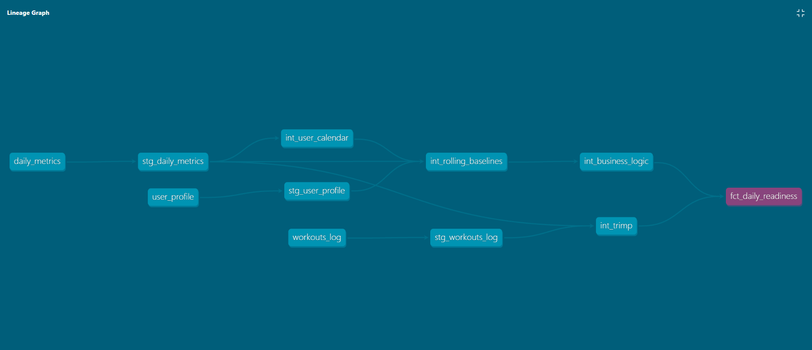

# Athlete Analytics & Injury Prevention System


A data pipeline and ML model that analyzes biometric load, CNS fatigue, and hormonal cycle adaptation to predict next-day training readiness and recommend a concrete daily action: train as planned, swap discipline, or rest.

Built as a proof of concept on **synthetic data**. This is not a clinical tool.

## About The Project

Athletes and physically active people often experience CNS fatigue and training overload that is hard to detect through subjective feeling alone. This project integrates HRV, sleep architecture, training load, blood biomarkers, and menstrual cycle phase to flag early overtraining signals and recommend a specific daily action, not just a generic "you're tired" alert.

The thought process, design decisions, and the problems I ran into (including data leakage) are described in the **[case study](case_study.md)**.

## Architecture

The project has two layers that currently run side by side:

| Layer | What it does |
|-------|--------------|
| **Python** (`athlete_analytics_project.py`) | Complete pipeline and source of truth for the ML model: imputation, cycle-aware baselines, EWMA/ACWR, Z-scores, anomaly detection, Random Forest, SHAP, weather gate, recommendation engine |
| **dbt + DuckDB** (`models/`) | SQL reimplementation of the logic that fits SQL: calendar spine, rolling baselines, TRIMP, rule-based business logic |

The Python pipeline does **not** read the dbt outputs yet. dbt serves as a reference implementation I compare against Python. Known differences between the two are documented in the case study (section 7).



### Python: core vs. optional modules

**Core (required for prediction to run):**
- Calendar re-indexing (fills gaps in non-consecutive training logs)
- KNN imputation of missing biometrics, per user
- Cycle-aware HRV/RHR baseline (per user and menstrual phase)
- EWMA-based ACWR (Acute:Chronic Workload Ratio)
- Layered CNS fatigue detection (CMJ/Grip, with an HRV Z-score + DOMS fallback for users without measurement equipment)
- RandomForestClassifier evaluated with a chronological `TimeSeriesSplit`
- Rule-based training recommendation engine

**Optional (pipeline runs without them):**
- PCA + KMeans clustering on blood biomarkers (needs enough data; on the 8-user sample it is inactive)
- IsolationForest anomaly detection
- SHAP explainability
- Open-Meteo weather gate (discipline-specific limits, applied to the latest day only; the result depends on the forecast at run time, see [LIMITATIONS.md](LIMITATIONS.md))

> **Note on evaluation:** the split is chronological, but features are built before the split using full-history statistics (see [LIMITATIONS.md](LIMITATIONS.md)). Reported metrics should be read as pipeline behavior on synthetic data, not as expected real-world performance.

### dbt layers

- **seeds** (`seeds/`): the raw CSVs, shared with the Python pipeline (e.g. `daily_metrics`, `workouts_log`)
- **staging**: loading, cleaning, standardization
- **intermediate**: `int_user_calendar`, `int_rolling_baselines`, `int_trimp`, `int_business_logic`
- **marts**: `fct_daily_readiness`

Total: 13 models (8 staging, 4 intermediate, 1 mart, organized in `models/staging`, `models/intermediate` and `models/marts`) and 8 seeds, plus data tests defined in the model YAML files and in `tests/`.

## Built With
Python · pandas · NumPy · scikit-learn · SHAP · dbt · DuckDB

## Dataset

All 8 CSV datasets are synthetically generated and live in `seeds/`. Both dbt (as seeds) and the Python pipeline read the same files, so the data sits in one place. They use a single standard format: comma delimiter and dot as the decimal separator (`fix_csv.py` is the one-off helper that normalized the original semicolon-delimited, decimal-comma files). `user_profile.csv` is built around eight distinct athlete profiles to stress-test the pipeline against realistic edge cases (see the case study).

## Getting Started

### Prerequisites
- Python 3.11 or newer (the CI runs on 3.11)

```sh
pip install -r requirements.txt
```

### Installation

```sh
git clone https://github.com/dominikafryc/athlete_analytics_project.git
cd athlete_analytics_project
```

The datasets are already in `seeds/`, so no extra files are needed.

## Usage

### Python pipeline

Run it locally rather than in a hosted notebook (e.g. Google Colab): the weather module geolocates from the IP of the machine running the script, so a hosted server gives the wrong location.

```sh
python athlete_analytics_project.py
```

Outputs:
- `fct_daily_readiness.csv`: enriched daily dataset for BI tools or ad-hoc analysis
- `readiness_model_v1.pkl`: trained model pipeline (preprocessing + classifier)

Note: the dbt mart `fct_daily_readiness` (built from `int_trimp` and `int_business_logic`, stored in DuckDB) and the CSV with the same name produced by Python are two independent implementations. Their comparison is described in the case study.

### dbt

The repository includes a `profiles.yml` (DuckDB file `dev.duckdb`), so no extra configuration is needed. Run the commands from the project root:

```sh
dbt deps      # installs dbt_utils (see packages.yml)
dbt build     # loads seeds, runs models and tests
dbt docs generate && dbt docs serve
```

## Testing

Tests run automatically on every push and pull request via GitHub Actions (`dbt build` + `pytest`, see `.github/workflows/ci.yml`).

### Python (decision-logic unit tests)

Cover the rule-based decision functions: `is_weather_safe`, `get_adapted_discipline`, `get_cns_fatigue_level`, `check_discipline_swap`.

```sh
python -m pytest -v
```

### dbt (data quality)

```sh
dbt build   # loads seeds, runs models and all tests
dbt test    # runs tests only
```

**Generic tests (defined in the model YAML files)**

| Test | Where | What it checks |
|------|-------|----------------|
| `unique_combination_of_columns` | `stg_daily_metrics`, `int_business_logic`, `fct_daily_readiness` | The grain `user_id` + `date` is unique at every layer (no join fan-out, no hidden duplicates behind `select distinct`) |
| `unique`, `not_null` | `stg_user_profile.user_id` | Valid primary key |
| `not_null` | `stg_daily_metrics`, `fct_daily_readiness` keys | Keys are always present |
| `relationships` | `fct_daily_readiness.user_id` | Every row belongs to a known user |
| `accepted_values` | `cns_fatigue_level`, `age_group` | Categorical outputs contain only expected labels |

**Singular tests (`tests/`)**

| Test | What it checks |
|------|----------------|
| `assert_calendar_has_no_gaps` | No missing days between a user's first and last date |
| `assert_business_logic_covers_calendar` | Row count of the final model equals the calendar spine |
| `assert_hrv_baseline_is_valid` | HRV baseline is positive and within the user's observed range |
| `assert_level_matches_index` | Text levels and numeric indexes (insomnia, CNS fatigue) never disagree |
| `assert_target_matches_next_day_status` | `Target_Readiness_Tomorrow` equals the next day's `Readiness_Status_Today` |
| `assert_trimp_is_non_negative` | Scaled daily TRIMP is never negative |

### Python vs. dbt parity report

`compare_report.py` is not a pass/fail test. It compares the dbt mart with the Python output column by column and reports the share of differing values, NULL mismatches and absolute differences. It is not part of the CI because it needs the Python output, which depends on live weather data.

```sh
python compare_report.py parity_report_before.csv   # the output file name is optional
```

The baseline result is stored in `parity_report_before.csv`. Results and their causes are described in the [case study](case_study.md), section 7.

## Status & Further Documentation

- Case study: [case_study.md](case_study.md)
- Known limitations: [LIMITATIONS.md](LIMITATIONS.md)
- Planned next steps: [ROADMAP.md](ROADMAP.md)

## License

Distributed under the MIT License.

## Contact

Dominika Fryc - dominikafryc48@gmail.com
