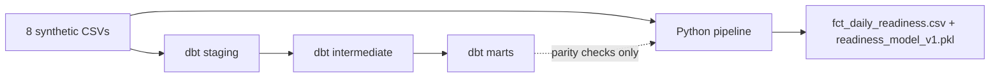

# Case Study: Athlete Analytics & Injury Prevention System

> All numbers below come from runs on the synthetic dataset (720 user-days, 8 users).

## 1. Motivation

The concept for this project stemmed from the real-world experiences and challenges faced by myself and my physically active friends. I noticed a recurring personal struggle with interpreting my body's signals for rest and deciding on an appropriate daily exertion level, which often led to chronic fatigue, overtraining, nervous system overload, injuries, decreased energy, and even weakened immunity. My friends experienced similar issues.

By leveraging available biometrics and indicators, this project aims to recommend the optimal daily action (train as planned, swap discipline, or rest) while reflecting the user's current physiological state, ultimately helping to prevent destructive training patterns.

My main goal in writing this case study is to show my thought process: what I built, why I made each decision, what went wrong, and what I would do differently.

## 2. Dataset

The dataset is synthetic, generated via Python scripts, yet designed to closely mirror realistic measurements. It was built to capture diversity and edge cases, including various age groups and genders. It accounts for scenarios such as users not wearing sleep trackers or taking weekends off, post-injury athletes, individuals with chronic illnesses, and multi-disciplinary athletes with varying training experience. It also incorporates menstrual cycle phases for female athletes, modeling natural heart rate fluctuations that are independent of training load.

Since the data is generated artificially, the project is a proof of concept for the methodology, not a clinical physiological study. Model metrics describe performance on synthetic data only.

`user_profile.csv` is built around eight athlete profiles:

| # | Profile | Edge case it tests |
|---|---------|--------------------|
| 1 | Triathlete, 3 disciplines | Multi-discipline athlete with several swap candidates |
| 2 | User without sleep data (so also no HRV and RHR), 2 disciplines | Missing tracker data, which exercises imputation and the HRV fallback |
| 3 | Senior woman, 1 discipline | Age group effects and no alternative discipline to swap to |
| 4 | Woman, 3 disciplines | Menstrual cycle phases alongside multi-discipline experience |
| 5 | Professional runner, 2 disciplines | Professional-level training load and volume |
| 6 | Person with a chronic illness | Physiological baselines that deviate for reasons other than training |
| 7 | Post-injury athlete | Injury flag and a forced rest recommendation |
| 8 | New user (cold start) | Short history, so rolling baselines are barely established |

## 3. Architecture: Python and dbt

The project has two layers that currently run **side by side**:

- **Python** (`athlete_analytics_project.py`) is the complete pipeline and the source of truth for the ML model. It covers imputation, cycle-aware baselines, EWMA/ACWR, Z-scores, ferritin handling, anomaly detection, PCA/KMeans, the Random Forest, SHAP, the weather API and the recommendation engine.
- **dbt (DuckDB)** reimplements the part of the logic that fits SQL naturally: calendar spine, rolling baselines, TRIMP, and rule-based business logic. The raw CSVs are loaded as dbt seeds. The models are structured as staging (loading, cleaning, standardization), intermediate (`int_user_calendar`, `int_rolling_baselines`, `int_trimp`, `int_business_logic`) and a mart, `fct_daily_readiness`, which combines TRIMP and the business logic. Python's CSV output has the same name but is produced independently. The project has 13 models (8 staging, 4 intermediate, 1 mart) and 8 seeds.

**Important:** the Python pipeline does not read the dbt outputs. The two are not yet integrated, so dbt is a reference implementation I use to compare against Python, not part of the production path.

The decision to migrate part of the processing to dbt was driven by a desire to learn and expand my skill set, and because I believe moving certain metrics into a modeled SQL layer makes the project more maintainable and transparent. Certain elements were deliberately kept in Python because they do not belong in SQL: all ML models, API integrations, and complex indicators such as EWMA, Z-scores, ferritin imputation and cycle phases. EWMA, for example, weights recent workouts much more than those from a week ago. It can be computed recursively in SQL, but I judged Python to be its natural home.

Integrating dbt was also a practical testing ground, my first transition from isolated exercises to a full project.

## 4. Indicators and personalization

The project uses EWMA-based ACWR, TRIMP, sRPE, ANS balance (RHR and HRV Z-scores), insomnia levels, individual rolling baselines, and menstrual cycle phases. It also supports optional metrics: grip strength, countermovement jump (CMJ) height, and blood test results. Not all metrics are required, but a more complete dataset gives better predictions.

- **Individual baselines.** Deviations are measured against each user's own 30-day rolling baseline rather than rigid, generalized rules. In the future this could also support early detection of illness (for example viral infections); this is a motivation, not a validated feature.
- **Menstrual cycle phases.** HRV/RHR baselines are computed per user and cycle phase, because natural physiological changes occur during the cycle independently of training load and should be treated as normal states, not anomalies. Users without a cycle are labelled `Not_Applicable`, so missing data does not skew the model.
- **Subjective vs. objective load.** `Load_Discrepancy` compares subjective effort (sRPE) with objective load (scaled TRIMP) to separate perceived exhaustion from the actual physical effort. Poor sleep (insomnia indicators) and cognitive stress can make a workout feel more draining than it objectively was, so they are modeled separately. Future calendar integration could correlate a dense schedule with elevated cognitive stress.
- **Psychological stress** is a proxy (RHR Z-score minus HRV Z-score), not a psychological measurement.
- **Experience.** The idea is that a discipline the athlete has trained for one year is a bigger stressor than one trained for eight, regardless of raw volume. In the current implementation experience is used only when choosing an **alternative discipline** (the second or third discipline with at least 2 years of experience, preferring the longest). It is not yet a multiplier in the load metrics.
- **Data grain.** One row per user per day (`User_ID` + `Date`), enforced in dbt with a uniqueness test.

## 5. Target, model and recommendation engine

**Target.** `Readiness_Status_Today` is the ratio of today's HRV to the 30-day baseline: below 0.85 is `Low`, below 0.95 `Moderate`, otherwise `High`. The target `Target_Readiness_Tomorrow` is tomorrow's status. The model therefore predicts next-day HRV status, which I use as a proxy for readiness.

**Model.** Random Forest (300 trees, balanced class weights) with mean imputation and scaling, evaluated with `TimeSeriesSplit` (5 splits) on data sorted chronologically. Mean metrics across the 5 folds (macro-averaged): accuracy **0.646**, precision **0.400**, recall **0.429**, F1 **0.399**.

These numbers are modest, and they need context:

- **The classes are imbalanced:** `High` 78.4%, `Moderate` 16.4%, `Low` 5.2% (712 days with a known next-day target). Always predicting `High` would score about 78% accuracy. Balanced class weights make the model trade overall accuracy for better recall on the rare classes, so accuracy alone is misleading here and macro-F1 is the more informative metric.
- **The model does not beat a naive baseline.** A "tomorrow equals today" rule scores accuracy 0.687 and macro-F1 0.47 on the whole sample. This baseline was computed on the full sample and not fold by fold, so the comparison is indicative, not exact, but it points in one direction: on this dataset the model adds nothing over HRV persistence.
- **Why this is plausible.** The label is derived from HRV and several features are close variants of it (for example `HRV_Pct_Of_Baseline`), so the target is highly autocorrelated. The dataset is also tiny: 720 rows, 8 users and only 37 `Low` days, which is little for a 300-tree forest with about 28 features.
- Days with imputed HRV produce artificial labels (see section 6).

I treat the model as a working end-to-end component, not as a validated predictor. The more valuable parts of the project are the feature pipeline, the rule-based recommendation engine, and the honest evaluation. Improving the model would need more data, a fold-matched comparison against the baselines, and features that carry information beyond the HRV that defines the label.

**Recommendation engine (rule-based).** Rules are applied in priority order:
1. Unsafe weather → swap to indoor (designed, but inactive in the sample run, see below).
2. Injury flag → rest.
3. Severe CNS fatigue, anomaly flag, or high insomnia risk → rest.
4. Moderate CNS fatigue or mental fatigue flag → swap to a secondary discipline with enough experience; if none exists, rest.
5. Otherwise → train as scheduled.

CNS fatigue is detected in layers: CMJ drop vs. the 30-day baseline (−7% moderate, −15% severe), then grip strength drop (−5%, −10%), then a fallback on cycle-aware HRV Z-score and DOMS for users without measurement equipment. These thresholds are heuristic choices and have not been validated.

**Weather** is not a model feature. It is designed as a safety gate on the final recommendation: an Open-Meteo forecast (daytime window, 08:00–20:00) for the latest day in the data, checked against a configuration table of temperature, wind and storm limits per discipline. **In the current sample run this gate is inactive.** `discipline_weather_config.csv` is comma-delimited while the loader expects semicolons, so the table is read as a single column, no discipline match is found, and the pipeline defaults to "weather optimal". The weather module is therefore implemented and unit-tested at the function level, but it has no effect on the recommendation distribution shown above. A second, smaller issue: the fallback to the country capital's coordinates fails on an unexpected API response. Location itself comes from IP geolocation, which is approximate: in my runs it landed more than 100 km from my actual location, and in a hosted notebook (Google Colab) it would point to the provider's server, so I run the pipeline locally.

## 6. Biggest challenge: data leakage

The most significant challenge was data leakage across several pipeline stages. The primary cause was KNN imputation. It seemed ideal for simulating realistic physiological states, but it is fitted on each user's entire history, so future values influence the imputed past and leak into the features.

Moving part of the logic to dbt reduced this, because dbt keeps missing values as NULL instead of imputing them. It did **not** remove leakage entirely. I audited the remaining sources:

| Where | Mechanism | Layer |
|-------|-----------|-------|
| KNN imputation | fitted on the full per-user series | Python |
| Cycle-phase HRV/RHR baselines and Z-scores | mean/std over full history | Python |
| ANS Z-scores (stress score) | per-user mean/std over full history | Python |
| Static columns | `ffill().bfill()` carries future values backward | Python |
| Missing HRV fill | global mean of the whole table (all users, all dates) | Python and dbt |
| TRIMP scaling | min-max over all workouts | Python and dbt |
| IsolationForest, PCA, KMeans | fitted on all rows | Python |

Rolling baselines, EWMA and ACWR use only past and current days. The dbt TRIMP model looks up HR rest/max with a backward-looking ASOF join, which is cleaner than Python's backfill.

The evaluation split is chronological, but features are built **before** the split using full-data statistics. The reported metrics are therefore optimistic, and I treat them as proof of pipeline behavior, not as expected real-world performance.

The leakage is not caused by KNN as a method, but by fitting it on the whole series. A causal variant, fitted on an expanding window of past data only, would keep ML-based imputation and remove this leakage. I did not change it yet and prioritized documenting it honestly. It is on the roadmap.

## 7. Python vs. dbt parity

I compared the dbt mart `fct_daily_readiness` with the Python output on all 720 user-days. Both cover exactly the same user-date rows. The differences come from more than missing-value handling and floating-point precision.

**Where they agree (0.00% of values differ):** `Daily_HRV`, `Sleep_Duration`, `HRV_30day_Baseline`, `Sleep_30day_Baseline`, `Readiness_Status_Today`, `Target_Readiness_Tomorrow`, `TRIMP_Objective_scaled`, `Age`, `Age_Group`, and the observed values of mood, DOMS, motivation, sleep architecture, CMJ and grip. The target definition is therefore reproduced exactly in SQL.

**Where they differ:**

| Column | Result | Cause |
|--------|--------|-------|
| `CNS_Fatigue_Level` / `Index` | 12.0% of 465 comparable rows differ (max index gap 2); 255 more rows have a Python value but dbt NULL | Python imputes CMJ/grip/DOMS and falls back to an HRV Z-score; dbt uses measured values only and has no HRV fallback |
| `CMJ_Jump_cm_30day` | 2.3% of 177 values differ (mean 0.14 cm, max 1.26 cm) | Python averages imputed daily values; dbt averages measured days only |
| `Grip_Strength_kg_30day` | 31.6% of 177 values differ (mean 0.43 kg, max 1.69 kg) | Same cause as CMJ |
| Mood, DOMS, motivation, `Mental_Fatigue_Flag` | Python has a value where dbt is NULL on 279 rows (39%) | KNN imputation |
| CMJ, grip (daily values) | Python has a value where dbt is NULL on 121 rows | KNN imputation |
| `Insomnia_Risk_Level` / `Index` | Python has a value where dbt is NULL on 180 rows | No sleep data: Python's rule falls through to `LOW_RISK` / 0, dbt returns NULL |

Numeric values count as equal within 1% relative plus 0.01 absolute tolerance.

TRIMP matches in all 720 rows even though the two implementations look up HR rest/max differently (Python uses the same-day value after `ffill().bfill()`, dbt the latest earlier measurement with defaults 50 / 190). On this dataset the difference has no visible effect, but it could matter with real, irregular HR measurements. The division guard (`+ 1e-5` vs. `NULLIF(..., 0)`) also shows no effect.

I consider the dbt behavior more honest where it keeps NULLs. In particular, Python labels users without sleep data as low insomnia risk, which is a fabricated assessment. The two outputs are not equivalent, but they agree exactly on the readiness target and the HRV baselines.

## 8. Known weaknesses of the current design

- Users without a tracker get a constant (global mean) HRV, so their ratio is 1 and their status is always `High`. These rows should be flagged or excluded from labels.
- Baselines have a cold-start problem (with `min_periods=1`, the first day equals its own baseline) and include the current day.
- TRIMP is scaled per workout and then summed per day, so the minimum offset is applied once per workout and a day can exceed 1000.
- `Load_Discrepancy` compares sRPE with scaled TRIMP, and the two scales are not calibrated against each other.
- Thresholds (HRV ratios, CMJ/grip drops, insomnia rules) are heuristics.
- The optional blood-biomarker module (PCA + KMeans) needs more variance than a small synthetic sample provides: with 8 users it reports low variance and assigns `Health_Cluster_ID = -1` to everyone, so it carries no signal here. It would need a larger or real dataset.

Further details are in [LIMITATIONS.md](LIMITATIONS.md) and [ROADMAP.md](ROADMAP.md).

## 9. What I would do next

- Compare the model against fold-matched baselines (persistence and majority class) and look for features beyond the HRV that defines the label.
- Replace full-history KNN with causal imputation and compute Z-scores and phase baselines on expanding windows.
- Let Python consume the dbt marts, with orchestration (for example Dagster, Prefect or Airflow) so each tool runs in sequence and produces one unified forecast, instead of everything living in a single script.
- Add dbt tests and CI (uniqueness, accepted values, calendar completeness).
- Modularize the Python code into a package.
- Integrate user calendars so the model can assess available training time, review scheduled events and slot workouts into the agenda.

## 10. A note on AI usage

This was my first end-to-end project and the concept was entirely my own. AI was used as an assistant during execution: debugging, syntax formatting, finding specific technical solutions and reviewing documentation. It did not generate the architectural plan or the conceptual ideas.
